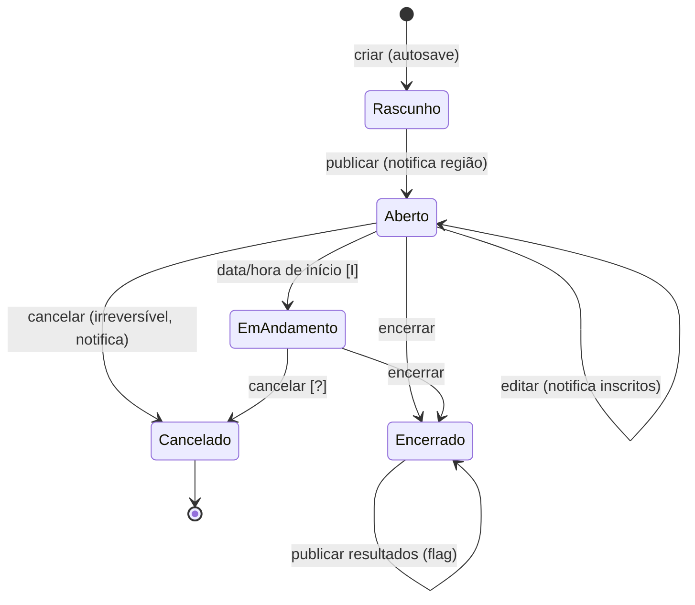
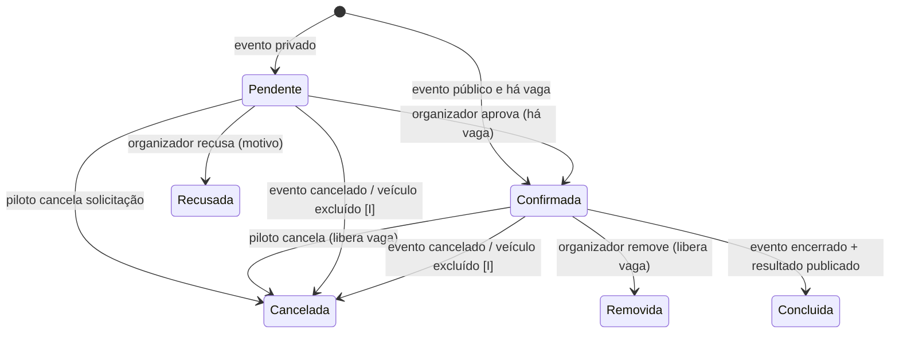

# Fast Street: Especificação Funcional, de Interface e de Dados

> **Fonte:** protótipo "Protótipo Fast Street" exportado do Claude Design (export de 2026-10, mais recente que o de `design/`: inclui as telas numeradas 1 a 10, o Protótipo Navegável, a Acessibilidade e o segundo chat). Os nomes de arquivo da seção 15 seguem esse export.
> **Objetivo deste arquivo:** servir de **contexto único** para prompts futuros de **desenvolvimento** (front-end, back-end e API) e de **modelagem de dados (DER/MER)**.
> **Convenção de confiabilidade:**
> - **[P]**: comportamento ou dado **explícito no protótipo** (código ou texto das telas).
> - **[I]**: **inferência** de modelagem ou de regra necessária para implementar e que o protótipo não define. Precisa de validação.
> - **[?]**: **lacuna ou inconsistência** encontrada. Ver a seção 13.

---

## Sumário

1. [Como usar este documento em prompts](#1-como-usar-este-documento-em-prompts)
2. [Visão do produto](#2-visão-do-produto)
3. [Papéis e permissões](#3-papéis-e-permissões)
4. [Plataformas e navegação](#4-plataformas-e-navegação)
5. [Design System (tokens e componentes)](#5-design-system-tokens-e-componentes)
6. [Glossário e enumerações de domínio](#6-glossário-e-enumerações-de-domínio)
7. [Catálogo de casos de uso](#7-catálogo-de-casos-de-uso)
8. [Especificação por tela](#8-especificação-por-tela)
9. [Regras de negócio consolidadas](#9-regras-de-negócio-consolidadas)
10. [Máquinas de estado](#10-máquinas-de-estado)
11. [Modelo de dados (base para o DER)](#11-modelo-de-dados-base-para-o-der)
12. [Requisitos não funcionais](#12-requisitos-não-funcionais)
13. [Lacunas, inconsistências e decisões pendentes](#13-lacunas-inconsistências-e-decisões-pendentes)
14. [Dados de exemplo (seed)](#14-dados-de-exemplo-seed)
15. [Mapa de arquivos do protótipo](#15-mapa-de-arquivos-do-protótipo)

---

## 1. Como usar este documento em prompts

Cole o arquivo inteiro (ou as seções relevantes) no prompt e acrescente a instrução. Modelos:

**DER:**
> Com base na seção 11 (e nas regras da seção 9) da especificação Fast Street anexada, gere o DER em notação Crow's Foot. Inclua PK/FK, cardinalidades, enums e constraints. Resolva as decisões marcadas [?] na seção 13 com a opção recomendada e justifique.

**Script físico:**
> Usando a seção 11 (com as adaptações da 11.6), gere o DDL MySQL 8 (InnoDB, utf8mb4), índices, constraints CHECK, unicidade condicional por coluna gerada e as migrations em ordem.

**API:**
> Usando as seções 7, 9 e 10, gere o contrato OpenAPI 3.1 dos recursos Eventos, Inscrições, Veículos, Resultados e Ranking. Cada caso de uso deve ser um endpoint com seus códigos de erro.

**Front-end:**
> Implemente a tela "8.6 Garagem" com fidelidade pixel-perfect aos tokens da seção 5. Inclua todos os estados (sucesso, carregando, vazio, erro, offline) e as validações da seção 9.

**Testes:**
> Gere cenários BDD (Gherkin) para as regras RN-INS-* e as transições da seção 10.2.

---

## 2. Visão do produto

**Fast Street** é um app para **pilotos amadores** e **organizadores** de eventos automotivos **legalizados, em locais autorizados**: autódromos, pistas de arrancada e áreas privadas. O lema do splash é *"Eventos legalizados em locais autorizados."* **[P]**

Proposta de valor, pelos 3 slides de onboarding **[P]**:
1. **Sua garagem virtual:** o piloto cadastra carros com fotos e especificações e escolhe o principal para se inscrever em eventos.
2. **Eventos no mapa:** track days, arrancadas autorizadas e encontros em autódromos e áreas privadas perto de você.
3. **Suba no ranking:** resultados publicados pelos organizadores viram pontos, pódios e conquistas.

**Escopo do MVP:** Paraná. O rodapé de Configurações diz "Fast Street · versão 1.0.0 (MVP Paraná)". **[P]**

**Fora de escopo explícito:** pagamento. O texto da tela é *"O Fast Street não processa pagamentos. Taxas, se houver, são combinadas com o organizador."* **[P]**

**Privacidade de localização:** *"Sua posição nunca aparece para outros usuários. O mapa mostra apenas eventos e parceiros."* **[P]**

**KPI de onboarding:** o fluxo Cadastro → Feed deve terminar em **até 2 minutos**. O protótipo mede esse tempo com um cronômetro. **[P]**

---

## 3. Papéis e permissões

| Papel | Escolha no cadastro | Capacidades |
|---|---|---|
| **Piloto** | "Piloto: Garagem, inscrições e ranking" | Garagem, inscrição em eventos, ranking, conquistas, histórico |
| **Organizador** | "Organizador: Criar eventos e publicar resultados" | Central do Organizador: criar, editar, cancelar e encerrar eventos, gerenciar inscrições e registrar resultados |
| **Piloto e Organizador** | "Os dois papéis na mesma conta" | União dos dois |

- O Organizador fornece no cadastro **nome da organização, CPF ou CNPJ e telefone**, que são os "Dados para verificação do organizador". **[P]**
- O selo **"Organizador verificado"** aparece no perfil e no detalhe do evento. Isso implica um processo de verificação. **[I]**
- Uma conta **só Organizador** pula o cadastro do primeiro veículo e recebe o toast "Conta criada · bem-vindo à Central do Organizador". **[P]**
- **Acesso à Central:** fica direto no **Perfil**, num card "Central do Organizador · Seus eventos, inscrições pendentes e resultados" com um badge de pendências. Antes ficava em Configurações → "Modo de uso"; o usuário pediu para tirar de lá por ficar "escondido". **[P]**
- No desktop, a sidebar tem a seção "Organizador → Central do Organizador (badge de pendências)". **[P]**
- **Moderação ou admin:** existe implicitamente, porque denúncias são "analisadas pela equipe em até 24 h" e organizadores são "verificados". Não há tela de admin. **[I]**

---

## 4. Plataformas e navegação

### 4.1 Breakpoints

| Contexto | Largura | Telas |
|---|---|---|
| **Mobile** (principal) | **390 px** (frame do protótipo 390×844, com status bar 9:41) | Onboarding/Login, Feed, Mapa/Inscrição, Detalhe, Garagem, Ranking, Perfil, Notificações |
| **Desktop** | **1440 px** (frame 1440×900/956) | Central do Organizador; Feed + Mapa lado a lado |

### 4.2 Navegação mobile **[P]**
- **Bottom nav com 5 itens:** Feed (`ph-house-simple`), Mapa (`ph-map-trifold`), Garagem (`ph-garage`), Ranking (`ph-trophy`), Perfil (`ph-user-circle`).
- Sino de **Notificações** no header do Feed (ícone `ph-bell`).
- Bottom sheets para filtros, pin do mapa, denúncia, cancelamento, conquistas, LGPD e logout.

### 4.3 Navegação desktop **[P]**
- **Sidebar** com a marca "Fast Street" (ícone `ph-flag-checkered` em quadrado de borda laranja), os itens Feed, Mapa, Garagem, Ranking e Perfil, a seção **Organizador** (Central do Organizador, com badge) e **Notificações**. No rodapé, o avatar do usuário com iniciais, o nome e a linha "Piloto · Cascavel, PR" ou o nome da organização.

### 4.4 Mapa de navegação entre telas (Protótipo Navegável) **[P]**

| Origem | Gatilho | Destino |
|---|---|---|
| Login/Cadastro | Fim do onboarding (chega no Feed) | Feed |
| Qualquer tela mobile | Bottom nav | Feed / Mapa / Garagem / Ranking / Perfil |
| Qualquer tela | Ícone "Notificações" | Notificações |
| Feed | Card de evento / item "Esta semana" | Detalhe do evento |
| Feed | "Ver no mapa" | Mapa |
| Feed | "Ranking" | Ranking |
| Mapa | "Ver detalhes" (sheet do pin) | Detalhe do evento |
| Mapa | "Ver lista" | Feed |
| Mapa (resultado Pendente) | "Ver minhas inscrições" | Perfil → Minhas inscrições |
| Mapa (sem veículo / incompatível) | "Cadastrar veículo" | Garagem → Cadastro (UC-01) |
| Detalhe | "Inscrever-se" | Mapa → Inscrição Passo 1 |
| Detalhe / Notificações | "Voltar" | Histórico (back) |
| Notificações | Item "Resultado" | Perfil → Resultado do piloto (UC-32) |
| Notificações | Item "Conquista" | Perfil → Detalhe da conquista (UC-31) |
| Notificações | Demais itens | Detalhe do evento |
| Perfil | Card "Central do Organizador" | Central → Meus eventos |
| Perfil | Modal "Sair" → Sair | Login |
| Desktop sidebar | Feed/Mapa → Feed+Mapa desktop; Central → Central | |

---

## 5. Design System (tokens e componentes)

Base estrutural: **Nocturne**, com bordas que esmaecem, primário em **contorno** e sombras discretas. A **paleta é própria**, extraída de uma foto de referência. **Tema escuro é o padrão.** O tema claro existe só para componentes. **[P]**

### 5.1 Cores: paleta-base (da foto) **[P]**

| Token | Hex | Uso |
|---|---|---|
| `background` | `#1A2730` | Fundo do app |
| `neutral-warm` | `#424048` | Chips, tags, badges neutros (Rascunho, Encerrado) |
| `line` / slate | `#45586C` | Bordas, contornos de inputs e botões secundários |
| `secondary` (Gulf) | `#B0CEE2` | **Exclusivo** para pódio, conquistas, selos e o badge "Principal". Nunca em áreas grandes |
| `primary` (racing orange) | `#E95D2C` | Bordas de CTA, ícones, títulos grandes, item ativo |
| `primary-pressed` | `#A63E1B` | Hover e pressionado do primário; primário do tema claro |

### 5.2 Cores: derivadas e semânticas **[P]**

| Token | Hex | Uso |
|---|---|---|
| `surface` | `#22323E` | Cards, inputs |
| `surface-elevated` | `#2C3D4B` | Linhas internas, trilhos, cards selecionados, divisórias |
| `surface-active` | `#263845` | Card ativo (desktop) |
| `primary-text` | `#F28A62` | **Texto laranja em corpo** (≥ 5,5:1). `#E95D2C` mede ~4,4:1 e não atende AA para texto pequeno |
| `text` | `#F5F7FA` | Texto principal |
| `text-muted` | `#C9D2DC` | Texto de controles inativos |
| `text-secondary` | `#9AA4B2` | Legendas, metadados |
| `text-tertiary` | `#6B7F95` | Placeholders, "auto", variação neutra |
| `success` | `#22C55E` (texto `#4ADE80`) | Confirmada, Aberto, Inscrito |
| `warning` | `#F59E0B` (texto `#FBBF24`) | Pendente, Requer aprovação, Últimas vagas |
| `danger` | `#EF4444` (texto `#F87171`, alerta `#FCA5A5`) | Erros, Recusada, Esgotado, destrutivo |
| `info` | `#B0CEE2` | Toasts informativos |
| `chrome-bg` | `#0F171D` / `#141F27` | Fundo da página e da sidebar do protótipo/desktop |

**Tints (fundos translúcidos):** primário `rgba(233,93,44,.08–.16)`, sucesso `rgba(34,197,94,.14)`, aviso `rgba(245,158,11,.14)`, perigo `rgba(239,68,68,.14)`, gulf `rgba(176,206,226,.14)`. **[P]**

**Tema claro (somente componentes)** **[P]**: bg `#EEF3F7`, surface `#FBFCFD`, line `#B0CEE2`, text `#1A2730`, text-2 `#45586C`, primary `#A63E1B`.

### 5.3 Tipografia **[P]**
- **Display/numéricos:** **Barlow Condensed** (500/600/700), em caixa alta e com tracking amplo nos overlines (`letter-spacing .12–.16em`).
- **Corpo/UI:** **Inter** (400/500/600).

| Estilo | Especificação |
|---|---|
| display-xl | Barlow Condensed 56/1 |
| display-l | Barlow Condensed 40/1 |
| title | Barlow Condensed 28/1.1 |
| subtitle | Barlow Condensed 20/1.2 |
| overline | Barlow Condensed 600 12/1, uppercase, tracking .16em |
| body-l | Inter 16/1.6 · 400 |
| body | Inter 14/1.5 · 400 |
| label | Inter 14/1.2 · 500 |
| caption | Inter 12/1.4 · 400 |
| numeric | Barlow Condensed 600, `tabular-nums` (ex.: "1.240 PTS · P3 ↑2") |

### 5.4 Espaço, raio, elevação **[P]**
- **Grid de 8 pt:** 4, 8, 16, 24, 32, 48, 64.
- **Raios:** 8 (chips), 12 (controles; o mais usado), 16 (cards), 24 (bottom sheet). Também aparecem 6, 10, 14 e 20.
- **Alvo de toque mínimo:** 44×44.
- **Elevação** (borda + escuridão ambiente):
  - `elev-sm` (cards): `0 0 0 1px #2C3D4B`
  - `elev-md` (menus, toast): `0 0 0 1px #45586C, 0 6px 18px rgba(0,0,0,.45)`
  - `elev-lg` (sheet, modal): `0 0 0 1px #5D7189, 0 16px 40px rgba(0,0,0,.6)`
- **Foco:** anel `0 0 0 3px rgba(233,93,44,.25)`; Nocturne: `outline 2px solid accent; offset 2px`.
- **Item ativo de navegação:** `inset 2px 0 0 #E95D2C` (lateral) ou `inset 0 -2px 0 #E95D2C` (abas).
- **Ícones:** **Phosphor** (`@phosphor-icons/web@2.1.1`), nos pesos regular, `ph-bold` e `ph-fill`.

### 5.5 Componentes **[P]**

| Componente | Variantes / estados |
|---|---|
| **Botão** | Primário (contorno laranja, texto `#F28A62`), Secundário, Ghost, Destrutivo, Ícone, Bloco. Estados: padrão, hover, pressionado, desabilitado (opacidade .45), carregando |
| **Input** | Padrão, foco, erro (borda `#EF4444`, fundo `rgba(239,68,68,.06)`), desabilitado, ajuda (helper) |
| **Senha** | Botão olho (`ph-eye`/`ph-eye-slash`, `aria-pressed`, rótulo "Mostrar/Ocultar senha") + **medidor de força com 4 barras** |
| **Select** | Lista fechada (categorias, marcas, cidades) |
| **Checkbox** | Aceite de termos e de regras |
| **Chips** | Multi-select de categoria; chips compactos (não interativos) em cards; chip de filtro ativo removível |
| **Segmented control** | Geral/Por categoria; Mensal/Semestral; Tudo/Este mês/Semestre |
| **Slider** | Raio de busca de 5 a 200 km |
| **Switch** | Preferências de notificação |
| **Stepper** | Wizard de 4 passos do organizador (✓ concluído, número atual) |
| **Badges** | Status do evento, status da inscrição, visibilidade, tipo de local, tipo de evento (overline) |
| **Selos** | "Organizador verificado", "Principal", posição P1/P2/P3 (Gulf) |
| **Cards** | Evento (público / requer aprovação / skeleton), Veículo (principal / seleção na inscrição) |
| **Feedback** | Toast (ok / info / erro com ação), banner offline, erro com retry, empty state, upload com progresso individual |
| **Superfícies** | Bottom sheet, modal de confirmação, sidebar desktop, bottom nav |
| **Image slot** | Placeholder de imagem (capa de evento, foto de carro, avatar), arrastável no protótipo |

### 5.6 Padrões transversais de estado **[P]**
Toda tela de dados tem os estados **Sucesso**, **Carregando (skeleton)**, **Vazio**, **Erro com "Tentar novamente"** e **Offline**. O offline mostra um banner *"Exibindo dados salvos · atualizado há N min"* e o ícone `ph-wifi-slash` na status bar.

---

## 6. Glossário e enumerações de domínio

| Enum | Valores (código → rótulo) | Fonte |
|---|---|---|
| **TipoEvento** | `td` → Track Day; `arr` → Arrancada Autorizada; `des` → Desafio em Pista; `enc` → Encontro | [P] |
| **TipoLocalAutorizado** | Autódromo; Pista de Arrancada; Área Privada | [P] |
| **Categoria** (de veículo e de evento) | Street Legal; Turismo; Aspirado; Turbo; Clássicos | [P] |
| **Visibilidade** | `pub` → Público ("Inscrições confirmadas automaticamente até esgotar as vagas"); `priv` → Privado / "Requer aprovação" ("Cada inscrição exige sua aprovação na Central") | [P] |
| **StatusEvento** | `rascunho`, `aberto`, `andamento` (Em andamento), `encerrado`, `cancelado` (+ flag "resultados publicados") | [P] |
| **StatusInscricao** | `pend` (Pendente / Aguardando aprovação), `conf` (Confirmada), `rec` (Recusada), `rem` (Removida pelo organizador), `canc` (Cancelada por você), `done` (Concluída, com resultado) | [P] |
| **PerfilConta** | `piloto`, `org`, `ambos` | [P] |
| **Marca** (lista fechada no MVP) | Chevrolet, Ford, Honda, Toyota, Volkswagen | [P] |
| **Cidades** (MVP) | Cascavel, Curitiba, Londrina, Maringá, Toledo (PR); no mapa também Foz do Iguaçu, Guarapuava, Medianeira | [P] |
| **TipoNotificacao** | `confirmed`, `pending`, `approved`, `rejected`, `newEvent`, `reminder`, `result`, `achievement` (8 tipos) | [P] |
| **PreferenciaNotificacao** | `conf` (confirmada/aprovada), `rec` (recusada), `near` (novo evento na região), `remind` (lembrete), `result` (resultado publicado), `ach` (conquista; padrão **desligado**) | [P] |
| **MotivoDenuncia** | Local não é autorizado; Atividade fora do local informado; Informações falsas ou enganosas; Conteúdo impróprio; Outro motivo | [P] |
| **PremioOrganizador** | Piloto destaque (`ph-star`); Espírito esportivo (`ph-handshake`); Estreia no pódio (`ph-medal`); Melhor preparação (`ph-wrench`) | [P] |
| **PeriodoRanking** | Mensal (ex.: "Outubro 2026"); Semestral (ex.: "2º semestre 2026") | [P] |
| **EscopoRanking** | Geral; Por categoria | [P] |
| **TipoParceiro** | Oficina parceira; Loja parceira | [P] |
| **App de rota** | Google Maps; Waze | [P] |

**Tabela de pontuação por posição** **[P]**: `P1=25, P2=18, P3=15, P4=12, P5=10, P6=8, P7=6, P8=4, P9=2, P10=1`, e 0 a partir de P11. O organizador pode sobrescrever o valor (fica marcado como "editado"; "auto" volta ao padrão).

---

## 7. Catálogo de casos de uso

| UC | Nome | Ator | Tela/arquivo |
|---|---|---|---|
| UC-00 | Cadastro (criar conta) | Visitante | 1 · Login |
| UC-01 | Cadastrar veículo (primeiro e demais) | Piloto | 1 · Login (passo 4) / 5 · Garagem |
| UC-02 | Listar garagem (com principal) | Piloto | 5 · Garagem |
| UC-03 | Feed de eventos | Usuário | 2 · Feed / 10 · Desktop |
| UC-04 | Mapa de eventos e parceiros | Usuário | 3 · Mapa / 10 · Desktop |
| UC-05 | Inscrição em evento (2 passos + resultados) | Piloto | 3 · Mapa |
| UC-06 | Central do Organizador: Meus eventos | Organizador | 4 · Central |
| UC-07 | Registrar resultados | Organizador | 4 · Central |
| UC-08 | Ranking | Usuário | 8 · Ranking / 4 · Central |
| UC-09 | Notificações (central + push) | Usuário | 9 · Notificações |
| UC-10 | Login | Visitante | 1 · Login |
| UC-11 | Recuperar senha (3 passos + concluído) | Visitante | 1 · Login |
| UC-16 | Dados opcionais do perfil | Usuário | 1 · Login (passo 2) |
| UC-17 | Upload de fotos do veículo [I] | Piloto | 5 · Garagem |
| UC-18 | Perfil | Usuário | 7 · Perfil |
| UC-19 | Detalhe do veículo / Tornar principal | Piloto | 5 · Garagem |
| UC-20 | Editar veículo | Piloto | 5 · Garagem |
| UC-21 | Especificações técnicas do veículo [I] | Piloto | 5 · Garagem |
| UC-22 | Filtros do Feed | Usuário | 2 · Feed |
| UC-23 | Pin / cluster do mapa (bottom sheet) | Usuário | 3 · Mapa |
| UC-24 | Inscrição pendente (evento privado) | Piloto | 3 · Mapa |
| UC-25 | Criar evento (wizard de 4 passos) | Organizador | 4 · Central |
| UC-26 | Editar evento | Organizador | 4 · Central |
| UC-27 | Cancelar evento | Organizador | 4 · Central |
| UC-28 | Revisar e publicar resultados | Organizador | 4 · Central |
| UC-29 | Ranking atualizado (pós-publicação) | Organizador | 4 · Central |
| UC-31 | Conquistas (lista e detalhe) | Piloto | 7 · Perfil |
| UC-32 | Histórico e resultado do piloto | Piloto | 7 · Perfil |
| UC-33 | Gerenciar inscrições | Organizador | 4 · Central |
| UC-34 | Remover piloto | Organizador | 4 · Central |
| (s/ nº) | Detalhe do evento; Denunciar evento; Cancelar inscrição; Minhas inscrições; Editar perfil; Configurações/LGPD; Acessibilidade | Diversos | 6, 7, Acessibilidade |

> As IDs UC-12 a UC-15 e UC-30 não aparecem no protótipo. A numeração vem do briefing original do usuário, que não está no bundle. **[?]**

---

## 8. Especificação por tela

### 8.1 Onboarding, Login e Cadastro (arquivo 1)

**Splash** **[P]**: imagem de fundo (grid de largada / autódromo à noite) e a marca "Fast / Street" com o lema. Avança sozinha para o carrossel após **1,8 s**.

**Carrossel (3 slides)**: Garagem → Eventos no mapa → Ranking, com indicador "01 / 03", dots, "Pular", CTA "Próximo" (no último, "Criar conta") e "Já tenho conta".

**UC-10 Login**
- Campos: E-mail e Senha (com olho). Links: "Esqueci minha senha", "Criar conta".
- Login social: **"Entrar com Google"** e **"Entrar com Apple"**.
- **Erro genérico:** "E-mail ou senha incorretos". Não revela qual campo está errado.
- **Conta não verificada:** "Confirme seu e-mail. Sua conta ainda não foi verificada. Abra o link que enviamos para {email} (confira também o spam)." O botão "Reenviar e-mail de verificação" leva a "E-mail reenviado. Você pode reenviar de novo em 60 s."

**UC-00 Cadastro (Passo 1 de 4)**
- Campos: E-mail, Senha (mínimo 8, com medidor de força), **Perfil** (Piloto / Organizador / Piloto e Organizador), Nome completo ("Como aparece no ranking"), Cidade (select), aceite de **Termos de Uso e Política de Privacidade (LGPD)**.
- Se o perfil for diferente de Piloto: Nome da organização, CPF ou CNPJ ("Somente números") e Telefone.
- Topo: resumo de erros "Revise N campos destacados." Se o e-mail já existe, aparece "E-mail já cadastrado." com o link "Entrar com este e-mail".
- Validações: ver RN-CAD-*.

**UC-16 Dados opcionais (Passo 2 de 4)**: foto de perfil (*"PNG, JPG ou JPEG · até 1024 KB"*), Bio (contador **/160**), Instagram e YouTube. Botões "Pular" e "Continuar".

**Pré-permissões (Passo 3 de 4)**
- **Localização:** explica o uso e reforça a privacidade. Botões "Permitir localização" e "Definir local manualmente". Simula o prompt nativo com "Permitir uma vez / ao usar o app / Não permitir".
- **Notificações:** lista o que será avisado (inscrição aprovada, novo evento na região, resultado e conquistas). Botões "Ativar notificações", "Agora não" e "Fazer depois". Simula o prompt nativo.

**UC-01 Primeiro veículo (Passo 4 de 4)**: "Necessário para se inscrever em eventos. Ele será o seu veículo principal." Fotos (**mínimo 3, máximo 6**, upload individual com % e "Tentar novamente"), Marca, Modelo, Ano, Cor, Categoria (chips) e **Especificações técnicas (opcional, recolhível)**: Motor, Potência (cv), Torque (kgfm), Peso (kg), Transmissão e Modificações (uma por linha). O CTA fica desabilitado com "Falta: …" até completar. Ao salvar: toast "Garagem pronta · {Marca Modelo} é seu veículo principal" e ida ao Feed.

**UC-11 Recuperar senha**
1. "Esqueceu a senha?": e-mail e "Enviar link".
2. "Verifique seu e-mail": link **válido por 30 min**, reenvio com **cooldown de 60 s**.
3. "Crie uma nova senha": nova senha (com medidor) e confirmação. Erro "As senhas não conferem."
4. "Senha alterada": *"Por segurança, encerramos as sessões abertas em outros aparelhos."*

### 8.2 Feed: UC-03 + UC-22 (arquivo 2)
- **Header:** kicker "Sua localização" (GPS) ou "Local escolhido" (manual), a cidade, "Alterar local", o botão Filtros com contador de filtros ativos e o sino.
- **Chips de filtros ativos**, removíveis, e "Limpar".
- **Seções:**
  - **"Perto de você"**: carrossel horizontal de cards, eventos a até **15 km**, com link "Ver no mapa".
  - **"Esta semana"**: lista compacta com dia da semana e dia, nome, "tipo de local · distância · visibilidade".
  - **"Destaques do ranking"**: líder de cada categoria (P1, nome, categoria · carro, PTS), com link "Ranking".
  - **"Novidades"**: posts do tipo "Resultado publicado" (organizador, há X dias) e "Novo parceiro".
- **Card de evento:** capa, badge de visibilidade, overline do tipo, nome, data, "tipo de local · distância", chips de categorias e barra de vagas com rótulo:
  - `left = 0` → "Vagas esgotadas" (vermelho)
  - `left ≤ 5` → "Últimas vagas" (âmbar)
  - senão → "Vagas restantes"; contagem "{left} de {total}"
- **Bottom sheet Filtros:** Categoria (multi), Data (Qualquer data / Esta semana / Este mês) e Distância (slider, padrão **50 km**, até **200 km**). Botões "Limpar" e "Aplicar filtros (N)". A contagem soma as categorias, +1 se a data não for "Qualquer" e +1 se a distância for diferente de 50.
- **Alterar local:** busca de cidade, "Usar minha localização atual" e uma lista de cidades.
- **Estados:** sucesso, skeleton, **vazio** ("Nada em {X} km com os filtros atuais…", com "Limpar filtros" e "Ampliar para 200 km"), **sem permissão de localização** ("Mostre eventos perto de você", com "Permitir" e "Definir manualmente"), offline e erro.

### 8.3 Mapa e Inscrição: UC-04, UC-23, UC-05, UC-24 (arquivo 3)
- **Mapa estilizado** (no protótipo não é um mapa real). Anel de raio rotulado em km, o **ponto do próprio usuário** (único ponto de pessoa) e rótulos de cidades.
- **Raio:** slider de **5 a 200 km**, padrão **15 km**, com a contagem "N eventos".
- **Filtro de tipo:** Todos, Track Day, Arrancada, Desafio, Encontro.
- **Pins:**
  - Eventos: círculo, borda laranja, ícone do tipo.
  - **Parceiros:** quadrado arredondado, borda **azul Gulf**. O toque abre um toast com nome e horário.
  - **Clusters:** pins a menos de 34 px de distância se agrupam e mostram a contagem. O toque abre o sheet "N itens neste local".
- **Header:** "Buscando perto de {cidade}", "Alterar" e o botão "Ver lista".
- **Sheet do pin (UC-23):** capa, tipo, nome, organizador, data, "tipo de local · local · distância", visibilidade, categorias, vagas e os botões "Abrir no Maps/Waze" (sheet com Google Maps / Waze), "Ver detalhes" e o **CTA**:
  - "Inscrever-se" (padrão) / "Inscrito" (verde) / "Inscrição pendente" (âmbar) / "Vagas esgotadas" (desabilitado).
- **Inscrição (UC-05):**
  - **Passo 1, Escolha o veículo:** "{evento} aceita {categorias}." O **veículo principal vem pré-selecionado**. Veículos de categoria não aceita aparecem desabilitados com "{cat} não é aceito neste evento".
  - **Passo 2, Revisar:** resumo do evento e do veículo/categoria ("Trocar"), a explicação da visibilidade, o checkbox **"Li as regras do evento e sei que o uso de equipamento de segurança é obrigatório"** e o aviso de que o app não processa pagamentos. O CTA diz "Confirmar inscrição" (público) ou "Enviar para aprovação" (privado).
- **Resultados da inscrição:**

| Resultado | Kicker | Título | CTA principal |
|---|---|---|---|
| ok | UC-05 · Confirmada | Inscrição confirmada ("Enviaremos um lembrete na véspera com o horário do briefing") | Abrir no Maps/Waze |
| pending | UC-24 · Pendente | Aguardando aprovação do organizador | Ver minhas inscrições |
| full | UC-05 · Vagas esgotadas | As vagas acabaram ("…preenchidas enquanto você revisava…") + **eventos parecidos com vagas** | n/a |
| incompat | UC-05 · Categoria incompatível | Veículo principal incompatível + **compatíveis na sua garagem** ("Usar este") | Cadastrar veículo (se nenhum compatível) |
| noveh | UC-05 · Sem veículo | Sua garagem está vazia ("Leva cerca de 1 minuto") | Cadastrar veículo |

- **Estados do mapa:** carregando, sem localização ("Onde você está?"), offline (cache), erro, vazio no raio ("Nenhum evento em X km", com "Ampliar").

### 8.4 Central do Organizador: desktop (arquivo 4)
**UC-06 Meus eventos:** abas **Rascunho, Abertos, Em andamento, Encerrados, Cancelados**, cada uma com contagem. A tabela tem as colunas Evento (nome, tipo · visibilidade), Data, Local (tipo), Inscritos/vagas (com barra; âmbar quando 100%), Pendências ("N pendentes" ou "—"), Status e Ações:
- Rascunho → "Continuar edição"
- Aberto / Em andamento → "Gerenciar"
- Encerrado sem resultados → **"Registrar resultados"** (destacado)
- Encerrado publicado → "Ver resultados"; status "Encerrado · resultados publicados"
- Botão "Criar evento". Vazio: "Nada por aqui. Nenhum evento neste status."

**UC-25 Criar evento (wizard de 4 passos)** com a mensagem "Rascunho salvo automaticamente" e uma **prévia ao vivo do card no app** ao lado:
1. **Informações:** Nome*, Tipo de evento* (4 cards), Descrição, Regras*, Capa (*"PNG, JPG ou JPEG · até 1024 KB"*).
2. **Categorias e vagas:** Categorias aceitas* ("escolha ao menos 1"), Limite de vagas* ("Total do evento, somando todas as categorias").
3. **Data e local:** Data*, Horário*, Local* (busca com sugestões de autódromos e pistas; **pin arrastável** e coordenadas lat/lng exibidas), **Tipo de local autorizado***.
4. **Visibilidade e revisão:** Público ou Privado e a revisão com "Editar" por linha. CTA "Publicar".
- O CTA "Continuar" valida o passo e mostra "{N} campo(s) para revisar". O stepper deixa voltar a passos concluídos.
- **Sucesso:** "Evento publicado · pilotos da região notificados", com "{nome} já aparece no Feed e no Mapa" e os botões "Ver em Meus eventos" e "Gerenciar inscrições".

**Tela do evento (gerenciar):** cabeçalho com tipo, status, nome, data, local e visibilidade, e as ações **Editar evento** (só se Aberto), **Cancelar evento** e **Encerrar evento** (se Aberto ou Em andamento). Sub-abas: **Inscrições | Resultados**.
- **Métricas:** Confirmadas/vagas (barra), Pendentes, Recusadas/removidas.

**UC-33 Gerenciar inscrições:** filtros Todas, Pendentes, Confirmadas e Recusadas (inclui removidas), busca por piloto ou veículo e uma tabela com Piloto (iniciais, nome, cidade), Veículo, Categoria, data e hora da inscrição, Status e Ações:
- Pendente: **Recusar** e **Aprovar**.
- Confirmada: **Remover** (modal UC-34).
- Aprovar sem vaga: alerta *"Não foi possível aprovar {nome}: vagas esgotadas ({conf}/{cap}). Aumente o limite ou remova uma inscrição."*
- Evento encerrado: banner *"inscrições não podem mais ser aprovadas nem removidas"*, com as ações desabilitadas.
- Evento cancelado: banner *"Os inscritos foram notificados e as inscrições ficaram bloqueadas."*
- Novo evento sem inscrições: *"Pilotos da região foram notificados. As inscrições aparecem aqui em tempo real."*

**UC-34 Remover piloto (modal):** *"{nome} ({carro}) será removido de {evento} e notificado. A vaga volta a ficar disponível."*

**UC-26 Editar evento:** reaproveita o wizard com o título "Editar evento" e o CTA "Salvar alterações". Toast *"Alterações salvas · inscritos notificados sobre a mudança"*. Validação extra de vagas ≥ confirmadas.

**UC-27 Cancelar evento (modal):** *"{nome} sai do Feed e do Mapa. Os N pilotos inscritos serão notificados. Esta ação não pode ser desfeita."*

**Encerrar evento (modal):** *"O status passa para Encerrado. Inscrições ficam bloqueadas e o registro de resultados é liberado."*

**UC-07 Registrar resultados**
- **Bloqueado** se o status não for Encerrado: *"Os resultados só podem ser registrados quando o status for Encerrado, para que o ranking reflita apenas provas concluídas."*
- Abas por **categoria** (com contagem de pilotos confirmados). As linhas são **reordenadas arrastando** ou com as setas Subir/Descer.
- Cada linha tem posição (P1–P3 em Gulf), piloto, carro, **pontos** (input, tag "auto" ou "editado"), prêmios concedidos e "Conceder prêmio" (modal com multi-select de PremioOrganizador).
- Resumo lateral por categoria: N pilotos · soma de pts.

**UC-28 Revisar resultados:** lista por categoria (P, nome, prêmios, pts). Botões "Voltar e editar" e **"Publicar resultados"**. Texto: *"Ao publicar, os pontos entram no ranking mensal e semestral, e cada piloto recebe uma notificação com seu resultado."*

**UC-29 Ranking atualizado:** banner "Ranking atualizado e pilotos notificados", "Ranking · Mensal · Outubro", seletor de categoria, **pódio** e a tabela Pos., **Var. (↑↓ calculada)**, Piloto, Carro, **Neste evento (+pts)** e Total.

### 8.5 Detalhe do evento (arquivo 6)
- **Hero** com "Voltar" e "Compartilhar". Tipo, badge de status (Aberto ou Encerrado), visibilidade e nome.
- **Organizador:** avatar com iniciais, nome e "Organizador verificado".
- Data por extenso, "08:00 às 17:00 · briefing 07:30"; local, "Cidade, UF · X km de você", "Local autorizado · {tipo}" e "Abrir no Maps/Waze".
- **Sobre**, **Regras** (lista; "Ver todas as regras" ou "Mostrar menos").
- **Vagas por categoria** (barra por categoria: "X de Y livres" ou "Esgotada") e o total.
- **Inscritos:** pilha de avatares e "N pilotos inscritos".
- **CTA fixo com 5 estados:**

| Estado | Rótulo | Nota abaixo | Ação |
|---|---|---|---|
| open | Inscrever-se | n/a | Abre a inscrição (UC-05) |
| pending | Inscrição pendente (desab.) | "Aguardando aprovação do {organizador}" | "Cancelar inscrição" |
| confirmed | Inscrito (desab.) | "Confirmada · {veículo} · {categoria}" | "Cancelar inscrição" |
| full | Vagas esgotadas (desab.) | "Todas as categorias estão completas" | n/a |
| closed | Ver resultados | "Evento encerrado em {data}" | Sheet de resultados |

- **Denunciar evento** (sempre visível): sheet com os 5 motivos (radio), "Detalhes (opcional)" e "Enviar denúncia", que fica desabilitado sem motivo. Texto: *"A denúncia é anônima para o organizador. Nossa equipe analisa em até 24 h."*
- **Cancelar inscrição (sheet):** *"Sua vaga volta a ficar disponível e o organizador é avisado. Você pode se inscrever de novo enquanto houver vagas."* Botões "Manter" e "Cancelar inscrição".
- **Resultados (sheet, evento encerrado):** "Publicado em {data}", o card "Seu resultado · {cat}" (P3, veículo, +pts) e a classificação por categoria com "(você)" destacado.

### 8.6 Garagem: UC-01, 02, 17, 19, 20, 21 (arquivo 5)
- **Lista:** cards ordenados com o **principal primeiro** (anel Gulf e badge "Principal"). Cada card mostra foto, nome, "ano · cor", categoria, linha de especificação ("205 cv · 1.5 Turbo 16V") e o ícone de **lixeira** (fica vermelho no hover). Botão "+ Veículo".
- **Vazio:** "Sua garagem está vazia. Cadastre seu primeiro veículo para se inscrever em eventos. Leva cerca de 1 minuto."
- **Detalhe (UC-19):** foto principal e 4 miniaturas, categoria, "Principal" ou **"Tornar principal"**, Especificações (Motor, Potência, Torque, Peso, Transmissão), Modificações (lista), **Histórico de eventos** (posição, evento, data · categoria, +pts) ou "Este veículo ainda não participou de eventos." Botões "Editar" e **"Excluir veículo"**.
- **Cadastro/Edição (UC-01/20):** mesmos campos de 8.1/UC-01. A edição já vem com as especificações abertas e tem "Remover foto" por miniatura e "Excluir veículo". O CTA é "Salvar veículo" ou "Salvar alterações".
- **Excluir (modal):** "Excluir {nome}?", com *"O histórico de eventos permanece no seu perfil. Inscrições futuras com este carro serão canceladas."* Se for o principal: *"Este é seu veículo principal. {próximo} passará a ser o principal."* ou *"Sua garagem ficará vazia."*
- **Toasts:** "Veículo cadastrado na garagem", "Alterações salvas", "{nome} agora é seu veículo principal", "{nome} excluído da garagem".

### 8.7 Perfil e Conquistas: UC-18, UC-31, UC-32 (arquivo 7)
- **Cabeçalho:** foto, nome, "cidade · @instagram", selos **Piloto** e **Organizador verificado**. Estatísticas: **Eventos** (14), **Pódios** (4), **Pontos** (121). Engrenagem leva a Configurações.
- **Ações:** "Editar perfil", "Minhas inscrições" (badge com as ativas = conf + pend) e o **card "Central do Organizador"** (badge de pendências).
- **Abas Conquistas | Histórico.**
  - **Conquistas (UC-31):** "X de Y desbloqueadas" e uma grade. As bloqueadas mostram progresso ("4 de 10"). O sheet de detalhe tem kicker (Desbloqueada/Bloqueada), nome, descrição, progresso e a data e origem do desbloqueio.
  - **Histórico (UC-32):** chips de categoria (Todas, Turbo, Clássicos, Turismo) e o segmented Tudo / Este mês / Semestre. Os itens mostram posição (Gulf se ≤ 3), evento, "data · cat · carro" e +pts. Vazio: "Nenhum evento neste filtro."
- **Resultado do piloto (UC-32):** evento, data · local, posição grande, "{cat} · Nº de M pilotos", carro, "+N PTS NO RANKING", "Prêmio do organizador: {prêmio}" e a classificação da categoria com "(você)" destacado.
- **Minhas inscrições:** abas **Próximas** (conf), **Pendentes** (pend) e **Histórico** (done, rec, canc). O item mostra mês e dia, nome, local, carro · categoria e um badge ("Confirmada", "Aguardando aprovação", "Recusada", "Cancelada por você" ou "P5 · +10 pts"). A ação é "Cancelar inscrição" (conf) ou "Cancelar solicitação" (pend). Cada aba tem seu empty state; o CTA "Explorar eventos" leva ao Mapa.
- **Editar perfil:** Foto (com a dica de formato), Nome completo*, Cidade (inclui Toledo), Bio (/160), Instagram e YouTube. Resumo "Revise os campos destacados." Toast "Perfil atualizado".
- **Configurações:**
  - **Notificações:** 6 switches (ver PreferenciaNotificacao).
  - **Privacidade · LGPD:** "Exportar meus dados" (sheet: *"arquivo JSON com todos os seus dados… link para {e-mail} em até 48 h"*), Política de Privacidade, Termos de Uso, **"Excluir conta"** (sheet: *"Seu perfil, garagem e inscrições serão apagados em até 30 dias. Resultados já publicados ficam anonimizados no ranking."*, exige digitar **EXCLUIR**).
  - "Sair" (modal "Sair da conta? Seus dados continuam salvos.").
  - Versão do app.

### 8.8 Ranking: UC-08 (arquivo 8)
- Título "Ranking" e o rótulo do período ("Outubro 2026" ou "2º semestre 2026").
- Segmented **Geral | Por categoria** e **Mensal | Semestral**. "Por categoria" adiciona um segundo nível de chips com as 5 categorias.
- **Pódio** (2º, 1º, 3º; o 1º com anel Gulf). Lista a partir do 4º com posição, **variação** (↑ verde, ↓ vermelho, — neutro), iniciais, nome, "categoria · carro" (no Geral) ou carro e pts. A linha do usuário fica destacada com "(você)".
- Rodapé **fixo "Sua posição"**: Nº, nome, "Subiu N posições" / "Caiu N" / "Sem variação" e pts.
- **Vazio:** *"Nenhum organizador publicou resultados de {categoria} ainda. Os pontos aparecem assim que o primeiro evento for encerrado."*, com "Ver ranking geral".

### 8.9 Notificações: UC-09 (arquivo 9)
- Central **agrupada por dia** (Hoje, Ontem, "Qua, 9 out"). O item tem ícone e cor por tipo, título, corpo e hora, e as **não lidas** aparecem com fundo de surface e peso 600.
- "Ler todas" marca todas como lidas. Tocar num item marca como lido e navega (ver 4.4).
- **Push na tela de bloqueio:** remetente "Fast Street", tempo e texto. O toque abre a notificação correspondente.
- Estados: sucesso, **vazio** ("Tudo em dia"), carregando, erro, offline.

| Tipo | Ícone / cor | Exemplo de título | Destino |
|---|---|---|---|
| reminder | `ph-alarm` laranja | "Lembrete: Track Day Zilmar Beux hoje" | Detalhe do evento |
| approved | `ph-bold ph-check` verde | "Inscrição aprovada" | Detalhe do evento |
| result | `ph-fill ph-trophy` Gulf | "Resultado publicado: Etapa 2" | Resultado do piloto |
| achievement | `ph-fill ph-medal` Gulf | "Conquista desbloqueada: Frequente" | Detalhe da conquista |
| newEvent | `ph-flag-checkered` laranja | "Novo evento a 9,8 km" | Detalhe do evento |
| pending | `ph-hourglass-medium` âmbar | "Inscrição pendente" | Detalhe do evento |
| confirmed | `ph-fill ph-check-circle` verde | "Inscrição confirmada" | Detalhe do evento |
| rejected | `ph-x-circle` vermelho | "Inscrição recusada" (com motivo) | Detalhe do evento |

### 8.10 Feed e Mapa desktop (arquivo 10)
- Layout em **split**: lista à esquerda, mapa à direita (732×760).
- **Toolbar:** localização ("Sua localização · Cascavel, PR · Alterar local"), **busca** ("Buscar evento, autódromo ou cidade", que filtra por nome e local), chips de categoria, segmented de data, **slider de raio (padrão 25 km)** e "Limpar filtros".
- Lista **ordenada por distância** ("Mais próximos primeiro") com o contador "N eventos em X km".
- **Sincronia lista ↔ mapa:** hover no card destaca o pin; clicar no pin rola a lista até o card e abre um **popover** com resumo, "Abrir no Maps/Waze" e "Ver detalhes".
- **Zoom +/−:** ajusta o raio em passos de 5 km (até 50) e de 25 km (acima de 50), dentro de 5 a 200 km.
- Legenda: "Você" e "Evento". Estados: carregando, vazio, offline, erro.

### 8.11 Acessibilidade (componente `Acessibilidade.dc.html`)
- Barra vertical **presa à borda direita**, com o padrão dos sites gov.br e três botões:
  1. **Libras** (ícone de mão): painel "Libras" com um slot para o avatar do intérprete e o texto *"Toque em um texto da tela para traduzir para Libras."* No protótipo é **só visual**.
  2. **Alto contraste:** filtro `contrast(1.45) brightness(1.12) saturate(1.2)` na tela e o selo amarelo "Alto contraste ativo".
  3. **A+:** aumenta todas as fontes em **15%**.
- **Alto contraste e A+ ficam salvos** (`localStorage` chave `fs-a11y`) e valem para todas as telas.
- A barra ocupa só a área dos botões, sem bloquear toques. A posição vertical é configurável por tela.

---

## 9. Regras de negócio consolidadas

### 9.1 Conta e autenticação
- **RN-CAD-01** E-mail válido (`^\S+@\S+\.\S{2,}$`) e **único**. Duplicado → "E-mail já cadastrado." **[P]**
- **RN-CAD-02** Senha com **mínimo de 8** caracteres. **[P]**
- **RN-CAD-03** Força da senha (0–4 pontos): +1 se ≥ 8 caracteres; +1 se tem maiúscula **e** minúscula; +1 se tem dígito; +1 se tem símbolo **e** ≥ 10 caracteres. Senha não vazia sem nenhum ponto vale 1. Rótulos: fraca, razoável, boa, forte. Cores: `#EF4444`, `#F59E0B`, `#B0CEE2`, `#22C55E`. Abaixo de "boa", mostra a dica "combine maiúsculas, números e símbolos". **[P]**
- **RN-CAD-04** Nome completo e cidade são obrigatórios. **[P]**
- **RN-CAD-05** Perfil Organizador ou Ambos exige: nome da organização; documento com **11 dígitos (CPF) ou 14 (CNPJ)**, só números; telefone com **≥ 10 dígitos**. **[P]** Validar o dígito verificador de CPF/CNPJ. **[I]**
- **RN-CAD-06** Aceite de Termos e Política (LGPD) é obrigatório. Guardar a versão e a data do aceite. **[I]**
- **RN-CAD-07** A conta nasce **não verificada**; o login exige e-mail verificado. Reenvio de verificação com cooldown de **60 s**. **[P]**
- **RN-AUT-01** O erro de login é **genérico** ("E-mail ou senha incorretos"). **[P]**
- **RN-AUT-02** Login social com Google e Apple. **[P]**
- **RN-AUT-03** O link de redefinição vale **30 min**; reenvio com cooldown de **60 s**; a nova senha segue RN-CAD-02 e a confirmação precisa ser igual. **[P]**
- **RN-AUT-04** Redefinir a senha **encerra as sessões em outros aparelhos**. **[P]**
- **RN-PER-01** Bio com no máximo **160** caracteres. **[P]**
- **RN-PER-02** Instagram: `^@?[A-Za-z0-9._]{2,30}$`, normalizado com "@". YouTube: deve conter `youtube.com/` ou `youtu.be/`. Nome obrigatório. **[P]**

### 9.2 Garagem
- **RN-VEI-01** Obrigatórios: **≥ 3 fotos enviadas**, marca, modelo, **ano com 4 dígitos** e categoria. Cor e especificações são opcionais. **[P]**
- **RN-VEI-02** Fotos: **mínimo 3, máximo 6** por veículo; **PNG, JPG ou JPEG**; **até 1024 KB por foto**. Upload individual com progresso; uma falha não perde o formulário e permite "Tentar novamente". **[P]**
- **RN-VEI-03** O **primeiro veículo** vira o principal automaticamente. **[P]**
- **RN-VEI-04** Cada usuário tem **exatamente 1 veículo principal** se tiver ao menos um veículo. "Tornar principal" desmarca o anterior. **[P]**
- **RN-VEI-05** Excluir o principal promove outro veículo a principal. No protótipo, o primeiro restante. **[P]** Critério sugerido: o mais recente ou o de mais eventos. **[I]**
- **RN-VEI-06** Excluir um veículo **mantém o histórico de eventos** no perfil e **cancela as inscrições futuras** com aquele carro. **[P]** Implica soft delete ou snapshot dos dados do veículo na inscrição e no resultado. **[I]**
- **RN-VEI-07** Modificações em texto livre, uma por linha. **[P]**

### 9.3 Descoberta (Feed e Mapa)
- **RN-DES-01** A localização vem do GPS ou de uma cidade escolhida manualmente. Sem nenhuma das duas, não se calculam distâncias (estado "sem permissão"). **[P]**
- **RN-DES-02** "Perto de você" mostra eventos a **≤ 15 km**. "Esta semana" mostra eventos da semana corrente. **[P]**
- **RN-DES-03** Distância padrão do filtro do Feed: **50 km**. Raio padrão do Mapa: **15 km**. Raio padrão do desktop: **25 km**. Faixa de **5 a 200 km**. **[P]**
- **RN-DES-04** Filtro de categoria: o evento aparece se aceita **qualquer uma** das categorias selecionadas (OR). **[P]**
- **RN-DES-05** Rótulo de vagas: 0 → "Vagas esgotadas"; 1 a 5 → "Últimas vagas"; senão "Vagas restantes". **[P]**
- **RN-DES-06** O mapa só mostra **eventos e parceiros**. Nunca mostra outros usuários. **[P]**
- **RN-DES-07** Eventos **cancelados** e **rascunhos** não aparecem no Feed nem no Mapa. **[P/I]**
- **RN-DES-08** Pins próximos se agrupam em **clusters**. No protótipo o limite é de 34 px em tela; no app real, use clustering do provedor de mapa. **[P/I]**

### 9.4 Inscrição (piloto)
- **RN-INS-01** Para se inscrever é preciso ter **≥ 1 veículo**. Sem veículo → resultado "Sua garagem está vazia". **[P]**
- **RN-INS-02** A **categoria do veículo** precisa estar entre as **categorias aceitas** do evento. Os incompatíveis aparecem desabilitados com o motivo. **[P]**
- **RN-INS-03** O veículo principal vem pré-selecionado. Se o principal for incompatível, aparece o resultado "Categoria incompatível" com a lista de compatíveis ("Usar este") ou "Cadastrar veículo". **[P]**
- **RN-INS-04** É obrigatório aceitar as **regras do evento e o uso de equipamento de segurança**. **[P]** Guardar a data e hora do aceite. **[I]**
- **RN-INS-05** Evento **Público** → inscrição **Confirmada** na hora. Evento **Privado** → **Pendente** até o organizador decidir. **[P]**
- **RN-INS-06** A disponibilidade de vagas é **verificada de novo na confirmação** (concorrência). Se esgotou, mostra o resultado "As vagas acabaram" e sugere até 2 eventos parecidos com vaga, na mesma categoria do veículo. **[P]** Exige lock ou constraint transacional. **[I]**
- **RN-INS-07** Uma inscrição ativa (pendente ou confirmada) por piloto por evento. **[I]** O CTA passa a "Inscrito" ou "Inscrição pendente".
- **RN-INS-08** O piloto pode **cancelar**: confirmada ("Cancelar inscrição": libera a vaga e avisa o organizador) ou pendente ("Cancelar solicitação"). Pode se inscrever de novo enquanto houver vaga. **[P]**
- **RN-INS-09** O app **não processa pagamentos**. **[P]**
- **RN-INS-10** Inscrição confirmada gera um **lembrete na véspera** com o horário do briefing. **[P]**

### 9.5 Eventos (organizador)
- **RN-EVT-01** Obrigatórios por passo do wizard **[P]**:
  - P1: nome, tipo, regras ("Descreva as regras mínimas de segurança").
  - P2: ≥ 1 categoria; vagas > 0.
  - P3: data (**não pode estar no passado**), horário, local **escolhido na busca**, tipo de local autorizado.
  - P4: visibilidade (padrão Público).
- **RN-EVT-02** O limite de vagas é o **total do evento**, somando todas as categorias. **[P]** (ver 13, item 1)
- **RN-EVT-03** O rascunho é salvo automaticamente. **[P]**
- **RN-EVT-04** Publicar: o status vai a **Aberto**, o evento aparece no Feed e no Mapa e os **pilotos da região são notificados** (`newEvent`, conforme o raio ou a preferência `near`). **[P]**
- **RN-EVT-05** **Editar só com o evento Aberto.** As vagas não podem ficar **abaixo do número de confirmadas** ("Já existem N inscrições confirmadas…"). Salvar **notifica os inscritos**. **[P]**
- **RN-EVT-06** **Cancelar**: o evento sai do Feed e do Mapa, os inscritos são notificados e as inscrições ficam bloqueadas. É **irreversível**. **[P]**
- **RN-EVT-07** **Encerrar**: permitido com o evento Aberto ou Em andamento. Bloqueia aprovar e remover e libera os resultados. **[P]**
- **RN-EVT-08** Passagem de Aberto para **Em andamento**: no dia e horário do evento. **[I]** O protótipo mostra o status, mas não o gatilho.
- **RN-EVT-09** O local precisa ser de um **tipo autorizado**: Autódromo, Pista de Arrancada ou Área Privada. **[P]**
- **RN-EVT-10** A capa segue as mesmas restrições de upload (PNG/JPG/JPEG ≤ 1024 KB). **[P]**

### 9.6 Gestão de inscrições (organizador)
- **RN-GIN-01** Aprovar uma pendente só se **confirmadas < vagas**. Senão mostra um alerta de bloqueio. **[P]**
- **RN-GIN-02** Recusar uma pendente muda o status para Recusada e notifica o piloto (`rejected`, **com motivo**). **[P]** O campo de motivo não aparece na tela do organizador. **[?]**
- **RN-GIN-03** Remover uma confirmada pede confirmação, muda o status para **Removida**, notifica o piloto e **libera a vaga**. **[P]**
- **RN-GIN-04** Com o evento Encerrado ou Cancelado, **nenhuma** ação sobre as inscrições é permitida. **[P]**
- **RN-GIN-05** As inscrições aparecem em **tempo real** para o organizador. **[P]** (WebSocket/SSE ou polling **[I]**)

### 9.7 Resultados, pontuação e ranking
- **RN-RES-01** Os resultados só podem ser registrados com o evento **Encerrado**. **[P]**
- **RN-RES-02** Os resultados são registrados **por categoria**, com os pilotos **confirmados** daquela categoria. A ordem define a posição. **[P]**
- **RN-RES-03** Pontos padrão pela tabela 25-18-15-12-10-8-6-4-2-1. O organizador pode sobrescrever (≥ 0) e o sistema guarda a flag "editado". **[P]**
- **RN-RES-04** O organizador pode conceder **0..N prêmios** por piloto. Eles aparecem no perfil **após a publicação**. **[P]**
- **RN-RES-05** **Publicar** faz os pontos entrarem nos rankings **mensal e semestral**, notifica cada piloto (`result`) e marca o evento como "resultados publicados". **[P]** Editar depois de publicado: não definido. **[?]**
- **RN-RNK-01** O ranking é a **soma dos pontos** do piloto no período (mês ou semestre), no **geral** ou **por categoria**. **[P]**
- **RN-RNK-02** A **variação** (↑↓) compara a posição atual com a anterior. No protótipo é a posição antes da última publicação. **[P]** Exige um snapshot. **[I]**
- **RN-RNK-03** Desempate: não definido. **[?]** Sugestão: mais vitórias, depois mais pódios, depois o resultado mais recente.
- **RN-RNK-04** Na exclusão de conta, os resultados publicados ficam **anonimizados** no ranking. **[P]**
- **RN-RNK-05** O ranking por categoria usa a **categoria da inscrição** (snapshot), não a categoria atual do veículo. **[I]**

### 9.8 Conquistas
- **RN-CNQ-01** As conquistas do sistema, com seus critérios, estão na seção 14. Mostram o progresso ("cur de max") enquanto bloqueadas. **[P]**
- **RN-CNQ-02** O desbloqueio guarda a data e a origem (o evento). **[P]** Notifica com o tipo `achievement` (preferência `ach`, desligada por padrão). **[P]**

### 9.9 Denúncia, LGPD, notificações
- **RN-DEN-01** É obrigatório escolher um dos 5 motivos; detalhes são opcionais. A denúncia é **anônima para o organizador**, com **SLA de 24 h**. **[P]**
- **RN-LGPD-01** Exportação: arquivo **JSON** com perfil, garagem, inscrições e resultados, com link por e-mail em **até 48 h**. **[P]**
- **RN-LGPD-02** Exclusão de conta: confirmar digitando **"EXCLUIR"**. Os dados são apagados em **até 30 dias**; os resultados publicados ficam anonimizados. **[P]**
- **RN-NOT-01** O usuário liga e desliga 6 tipos de aviso. Padrão: todos ligados, exceto "Conquista desbloqueada". **[P]**
- **RN-NOT-02** Ler uma notificação a marca como lida. "Ler todas" marca todas. **[P]**

---

## 10. Máquinas de estado

### 10.1 Evento

### 10.2 Inscrição

### 10.3 Upload de foto
`enviando (0–100%) → enviada | erro → (tentar novamente) → enviando`. **[P]**

### 10.4 Conta
`não verificada → ativa → exclusão agendada (≤ 30 dias) → anonimizada/excluída`. **[P/I]**

---

## 11. Modelo de dados (base para o DER)

### 11.1 Entidades e atributos

> Convenções sugeridas: `id` UUID (PK); `created_at` e `updated_at` em todas as tabelas; nomes em snake_case e em português, para manter a linguagem ubíqua do produto.
>
> Os tipos abaixo (`citext`, `timestamptz`, `point`/`geography`, UNIQUE parcial) foram escritos em notação PostgreSQL. **O banco implementado é o MySQL 8**: a correspondência de cada um está na seção 11.6.

**USUARIO**: `id`, `email` (UNIQUE, citext), `senha_hash` (nullable se só login social), `nome_completo`, `cidade_id` (FK), `bio` (≤ 160), `instagram`, `youtube_url`, `foto_url`, `email_verificado_em`, `perfil` (enum piloto/org/ambos, ou ver 11.4-A), `termos_versao`, `termos_aceitos_em`, `localizacao_modo` (gps/manual), `status` (ativo, exclusao_agendada, anonimizado), `exclusao_solicitada_em`. **[P/I]**

**IDENTIDADE_EXTERNA** (login social): `id`, `usuario_id` (FK), `provedor` (google/apple), `sujeito` (UNIQUE por provedor). **[I]**

**TOKEN_AUTENTICACAO**: `id`, `usuario_id`, `tipo` (verificacao_email / redefinicao_senha), `token_hash`, `expira_em` (30 min na redefinição), `usado_em`, `ultimo_envio_em` (cooldown de 60 s). **[I]**

**SESSAO**: `id`, `usuario_id`, `dispositivo`, `criada_em`, `revogada_em`, para "encerrar sessões em outros aparelhos". **[I]**

**DISPOSITIVO_PUSH**: `id`, `usuario_id`, `plataforma` (ios/android/web), `token`, `ativo`. **[I]**

**ORGANIZADOR** (perfil de organização, 1:1 com o usuário que é org): `id`, `usuario_id` (FK UNIQUE), `nome_organizacao`, `documento` (CPF 11 / CNPJ 14), `tipo_documento`, `telefone`, `verificado` (bool), `verificado_em`. **[P/I]**

**CIDADE**: `id`, `nome`, `uf`, `geo` (point). **[P/I]**

**CATEGORIA** (lookup): `id`, `nome` (Street Legal, Turismo, Aspirado, Turbo, Clássicos). **[P]**

**MARCA** (lookup): `id`, `nome`. **[P]**

**VEICULO**: `id`, `usuario_id` (FK), `marca_id` (FK), `modelo`, `ano` (smallint, 4 dígitos), `cor`, `categoria_id` (FK), `principal` (bool), `motor`, `potencia_cv`, `torque_kgfm` (numeric(5,1)), `peso_kg`, `transmissao`, `modificacoes` (text), `excluido_em` (soft delete). **[P/I]**

**FOTO_VEICULO**: `id`, `veiculo_id` (FK), `url`, `ordem` (1–6), `mime` (png/jpeg), `tamanho_bytes` (≤ 1 048 576), `status_upload`. **[P/I]**

**LOCAL**: `id`, `nome` (ex.: Autódromo Zilmar Beux), `tipo_local` (enum Autódromo / Pista de Arrancada / Área Privada), `cidade_id`, `endereco`, `geo` (point; o pin pode ser ajustado). **[P]**

**EVENTO**: `id`, `organizador_id` (FK), `nome`, `tipo` (enum td/arr/des/enc), `descricao`, `regras` (text), `capa_url`, `vagas_total` (> 0), `inicio_em` (timestamptz), `fim_em` (ex.: 17:00), `briefing_em` (ex.: 07:30), `local_id` (FK), `geo_ajustado` (point, nullable), `visibilidade` (pub/priv), `status` (rascunho/aberto/andamento/encerrado/cancelado), `publicado_em`, `encerrado_em`, `cancelado_em`, `resultados_publicados_em`. **[P/I]**

**EVENTO_CATEGORIA** (N:N): `evento_id`, `categoria_id`, `vagas` (nullable; ver 13, item 1). PK composta. **[P/I]**

**INSCRICAO**: `id`, `evento_id`, `piloto_id` (usuario), `veiculo_id`, `categoria_id` (**snapshot** da categoria do veículo), `veiculo_descricao` (snapshot, ex.: "Honda Civic Si · 2019"), `status` (pend/conf/rec/rem/canc/done), `regras_aceitas_em`, `motivo_recusa`, `decidida_por` (usuario), `decidida_em`, `cancelada_em`. **[P/I]**
- UNIQUE parcial (`evento_id`, `piloto_id`) WHERE `status IN ('pend','conf')`. **[I]**

**RESULTADO**: `id`, `evento_id`, `categoria_id`, `inscricao_id` (FK UNIQUE), `posicao` (≥ 1), `pontos` (≥ 0), `pontos_editados` (bool). UNIQUE (`evento_id`, `categoria_id`, `posicao`). **[P/I]**

**CONQUISTA** (catálogo): `id`, `codigo` (first, podium, five, regular, win, ten, explorer, garage, hundred), `nome`, `descricao`, `icone`, `tipo` (automatica / premio_organizador), `meta` (int, nullable). Os prêmios do organizador (Piloto destaque etc.) entram aqui com `tipo = premio_organizador`, ou ver 11.4-D. **[P/I]**

**USUARIO_CONQUISTA**: `usuario_id`, `conquista_id`, `progresso_atual`, `desbloqueada_em`, `evento_origem_id` (nullable). PK (`usuario_id`, `conquista_id`) para as automáticas. **[P/I]**

**RESULTADO_PREMIO** (prêmio concedido pelo organizador): `resultado_id`, `conquista_id`. PK composta. **[P/I]**

**RANKING_SNAPSHOT** (opcional; ver 11.4-B): `id`, `periodo_tipo` (mensal/semestral), `periodo_ref` (ex.: 2026-10, 2026-S2), `categoria_id` (NULL = geral), `usuario_id`, `pontos`, `posicao`, `gerado_em`, `evento_gatilho_id`. **[I]**

**NOTIFICACAO**: `id`, `usuario_id`, `tipo` (8 tipos), `titulo`, `corpo`, `lida_em`, `evento_id` / `resultado_id` / `conquista_id` (referências nullable, ou `alvo_tipo` + `alvo_id`), `enviada_push_em`. **[P/I]**

**PREFERENCIA_NOTIFICACAO**: `usuario_id`, `tipo` (conf/rec/near/remind/result/ach), `ativo`. PK composta. **[P]**

**DENUNCIA**: `id`, `evento_id`, `denunciante_id` (oculto ao organizador), `motivo` (enum de 5), `detalhes`, `status` (aberta / em_analise / procedente / improcedente), `analisada_por`, `analisada_em`. **[P/I]**

**PARCEIRO**: `id`, `nome`, `tipo` (oficina/loja), `horario` (ex.: "seg a sáb"), `cidade_id`, `geo`, `descricao`. **[P]**

**NOVIDADE** (posts do Feed): `id`, `tipo` (resultado_publicado / novo_parceiro), `titulo`, `autor_descricao`, `imagem_url`, `evento_id` / `parceiro_id`, `cidade_id`, `publicada_em`. Alternativa: derivar de outros fatos (ver 11.4-E). **[P/I]**

**SOLICITACAO_LGPD**: `id`, `usuario_id`, `tipo` (exportacao/exclusao), `status`, `solicitada_em`, `prazo_em` (48 h / 30 dias), `concluida_em`, `arquivo_url`. **[P/I]**

**PREFERENCIA_ACESSIBILIDADE** (opcional; no protótipo é por dispositivo): `usuario_id`, `alto_contraste`, `fonte_ampliada`. **[I]**

### 11.2 Relacionamentos e cardinalidades

| Relacionamento | Cardinalidade | Observação |
|---|---|---|
| USUARIO → VEICULO | 1 : 0..N | Exatamente 1 `principal = true` quando N ≥ 1 (UNIQUE parcial) |
| VEICULO → FOTO_VEICULO | 1 : 3..6 | Mínimo garantido na aplicação; máximo via CHECK ou trigger |
| USUARIO → ORGANIZADOR | 1 : 0..1 | Existe se perfil ∈ {org, ambos} |
| ORGANIZADOR → EVENTO | 1 : 0..N | |
| LOCAL → EVENTO | 1 : 0..N | |
| CIDADE → LOCAL / USUARIO / PARCEIRO | 1 : 0..N | |
| EVENTO ↔ CATEGORIA | N : M | via EVENTO_CATEGORIA (≥ 1 por evento) |
| EVENTO → INSCRICAO | 1 : 0..N | Confirmadas ≤ `vagas_total` |
| USUARIO (piloto) → INSCRICAO | 1 : 0..N | 1 ativa por evento |
| VEICULO → INSCRICAO | 1 : 0..N | Categoria do veículo ∈ categorias do evento (na criação) |
| INSCRICAO → RESULTADO | 1 : 0..1 | Só inscrições confirmadas de eventos encerrados |
| RESULTADO ↔ CONQUISTA (prêmio) | N : M | via RESULTADO_PREMIO |
| USUARIO ↔ CONQUISTA | N : M | via USUARIO_CONQUISTA (progresso + desbloqueio) |
| USUARIO → NOTIFICACAO | 1 : 0..N | |
| USUARIO → PREFERENCIA_NOTIFICACAO | 1 : 6 | |
| EVENTO → DENUNCIA | 1 : 0..N | USUARIO → DENUNCIA 1 : 0..N |
| USUARIO → SOLICITACAO_LGPD | 1 : 0..N | |
| USUARIO → IDENTIDADE_EXTERNA / SESSAO / TOKEN / DISPOSITIVO_PUSH | 1 : 0..N | |

### 11.3 DER (Mermaid)

```mermaid
erDiagram
    USUARIO ||--o| ORGANIZADOR : "pode ser"
    USUARIO ||--o{ VEICULO : possui
    USUARIO }o--|| CIDADE : "mora em"
    USUARIO ||--o{ IDENTIDADE_EXTERNA : "login social"
    USUARIO ||--o{ SESSAO : abre
    USUARIO ||--o{ TOKEN_AUTENTICACAO : recebe
    USUARIO ||--o{ DISPOSITIVO_PUSH : registra
    USUARIO ||--o{ INSCRICAO : "se inscreve"
    USUARIO ||--o{ NOTIFICACAO : recebe
    USUARIO ||--o{ PREFERENCIA_NOTIFICACAO : configura
    USUARIO ||--o{ USUARIO_CONQUISTA : conquista
    USUARIO ||--o{ DENUNCIA : registra
    USUARIO ||--o{ SOLICITACAO_LGPD : solicita
    VEICULO ||--|{ FOTO_VEICULO : tem
    VEICULO }o--|| MARCA : "é da"
    VEICULO }o--|| CATEGORIA : "pertence a"
    VEICULO ||--o{ INSCRICAO : "usado em"
    ORGANIZADOR ||--o{ EVENTO : organiza
    EVENTO }o--|| LOCAL : "acontece em"
    LOCAL }o--|| CIDADE : "fica em"
    EVENTO ||--|{ EVENTO_CATEGORIA : aceita
    CATEGORIA ||--o{ EVENTO_CATEGORIA : "aceita em"
    EVENTO ||--o{ INSCRICAO : recebe
    EVENTO ||--o{ DENUNCIA : "alvo de"
    INSCRICAO }o--|| CATEGORIA : "compete em"
    INSCRICAO ||--o| RESULTADO : gera
    RESULTADO ||--o{ RESULTADO_PREMIO : recebe
    CONQUISTA ||--o{ RESULTADO_PREMIO : "concedida como"
    CONQUISTA ||--o{ USUARIO_CONQUISTA : "desbloqueada por"
    PARCEIRO }o--|| CIDADE : "fica em"
    RANKING_SNAPSHOT }o--|| USUARIO : classifica
    RANKING_SNAPSHOT }o--o| CATEGORIA : "escopo"

    USUARIO {
        uuid id PK
        citext email UK
        text senha_hash
        text nome_completo
        uuid cidade_id FK
        varchar bio "<=160"
        text instagram
        text youtube_url
        text foto_url
        enum perfil "piloto|org|ambos"
        timestamptz email_verificado_em
        timestamptz termos_aceitos_em
        enum status "ativo|exclusao_agendada|anonimizado"
    }
    ORGANIZADOR {
        uuid id PK
        uuid usuario_id FK,UK
        text nome_organizacao
        varchar documento "CPF 11 ou CNPJ 14"
        text telefone
        boolean verificado
    }
    VEICULO {
        uuid id PK
        uuid usuario_id FK
        uuid marca_id FK
        text modelo
        smallint ano
        text cor
        uuid categoria_id FK
        boolean principal
        text motor
        int potencia_cv
        numeric torque_kgfm
        int peso_kg
        text transmissao
        text modificacoes
        timestamptz excluido_em
    }
    FOTO_VEICULO {
        uuid id PK
        uuid veiculo_id FK
        text url
        smallint ordem "1..6"
        text mime "png|jpeg"
        int tamanho_bytes "<=1048576"
    }
    EVENTO {
        uuid id PK
        uuid organizador_id FK
        uuid local_id FK
        text nome
        enum tipo "td|arr|des|enc"
        text descricao
        text regras
        text capa_url
        int vagas_total ">0"
        timestamptz inicio_em
        timestamptz fim_em
        timestamptz briefing_em
        enum visibilidade "pub|priv"
        enum status "rascunho|aberto|andamento|encerrado|cancelado"
        timestamptz resultados_publicados_em
    }
    EVENTO_CATEGORIA {
        uuid evento_id PK,FK
        uuid categoria_id PK,FK
        int vagas "nullable"
    }
    LOCAL {
        uuid id PK
        text nome
        enum tipo_local "autodromo|pista_arrancada|area_privada"
        uuid cidade_id FK
        geography geo
    }
    INSCRICAO {
        uuid id PK
        uuid evento_id FK
        uuid piloto_id FK
        uuid veiculo_id FK
        uuid categoria_id FK "snapshot"
        enum status "pend|conf|rec|rem|canc|done"
        timestamptz regras_aceitas_em
        text motivo_recusa
        timestamptz decidida_em
    }
    RESULTADO {
        uuid id PK
        uuid evento_id FK
        uuid categoria_id FK
        uuid inscricao_id FK,UK
        smallint posicao
        smallint pontos
        boolean pontos_editados
    }
    CONQUISTA {
        uuid id PK
        text codigo UK
        text nome
        text descricao
        text icone
        enum tipo "automatica|premio_organizador"
        int meta
    }
    USUARIO_CONQUISTA {
        uuid usuario_id PK,FK
        uuid conquista_id PK,FK
        int progresso_atual
        timestamptz desbloqueada_em
        uuid evento_origem_id FK
    }
    NOTIFICACAO {
        uuid id PK
        uuid usuario_id FK
        enum tipo "8 tipos"
        text titulo
        text corpo
        text alvo_tipo
        uuid alvo_id
        timestamptz lida_em
    }
    DENUNCIA {
        uuid id PK
        uuid evento_id FK
        uuid denunciante_id FK
        enum motivo "5 motivos"
        text detalhes
        enum status
    }
    PARCEIRO {
        uuid id PK
        text nome
        enum tipo "oficina|loja"
        text horario
        uuid cidade_id FK
        geography geo
    }
```

### 11.4 Decisões de modelagem (com alternativas)

**A. Papéis do usuário**

| Opção | Prós | Contras |
|---|---|---|
| **A1. Enum `perfil` (piloto/org/ambos) + tabela ORGANIZADOR 1:0..1** (recomendada para o MVP) | Simples, reflete a tela de cadastro, poucas joins | Adicionar um papel (ex.: admin/moderador) exige migration do enum |
| A2. Tabela `USUARIO_PAPEL` (N:N com PAPEL) | Extensível (admin, moderador, parceiro), padrão RBAC | Mais joins; "ambos" vira 2 linhas |

**B. Ranking**

| Opção | Prós | Contras |
|---|---|---|
| B1. Calcular na hora (`SUM(pontos) GROUP BY` período/categoria) | Sempre consistente, zero redundância | Custo por leitura; a variação ↑↓ precisa de uma 2ª consulta "antes do último evento" |
| **B2. `RANKING_SNAPSHOT` gerado a cada publicação de resultados** (recomendada) | Leitura O(1), variação trivial (comparar snapshots), auditável | Redundância; exige job transacional na publicação e reprocessamento na anonimização |
| B3. Materialized view + refresh na publicação | Meio-termo, nativo do PostgreSQL | Não existe no MySQL 8; não guarda histórico de posições; a variação continua difícil |

**C. Vagas**

| Opção | Prós | Contras |
|---|---|---|
| **C1. Só `vagas_total` no EVENTO** (fiel ao wizard) | Simples; igual ao formulário | O Detalhe do Evento mostra vagas **por categoria**, o que fica sem fonte |
| C2. `vagas` em EVENTO_CATEGORIA, e o total é a soma | Atende o Detalhe e permite controle fino | O wizard precisa de um campo por categoria (mudança de UI) |
| C3. Os dois (total obrigatório, por categoria opcional e ≤ total) | Flexível | Duas regras de lotação para validar |

**D. Prêmios do organizador vs. conquistas automáticas**

| Opção | Prós | Contras |
|---|---|---|
| **D1. Uma tabela CONQUISTA com `tipo`** (recomendada) | O perfil lista tudo de modo uniforme ("aparecem no perfil do piloto") | Atributos que só servem a um tipo (`meta`) ficam nulos no outro |
| D2. Tabelas separadas PREMIO e CONQUISTA | Semântica mais limpa | UNION para exibir no perfil |

**E. Novidades do Feed**

| Opção | Prós | Contras |
|---|---|---|
| E1. Tabela NOVIDADE (posts editoriais) | Controle editorial, permite conteúdo manual | Precisa de CMS ou admin |
| **E2. Derivar de fatos (resultado publicado, novo parceiro) via view ou outbox** (recomendada no MVP) | Sem trabalho editorial; sempre atualizado | Menos flexível para campanhas |

**F. Referência polimórfica em NOTIFICACAO**

| Opção | Prós | Contras |
|---|---|---|
| **F1. `alvo_tipo` + `alvo_id`** | Uma coluna serve aos 8 tipos e é extensível | Sem FK real (integridade pela aplicação) |
| F2. FKs nullable (`evento_id`, `resultado_id`, `conquista_id`) + CHECK de exclusividade | Integridade referencial | Mais colunas; um alvo novo exige migration |

**G. Exclusão de veículo e conta**: use **soft delete** (`excluido_em`) e **snapshots** na INSCRICAO (`categoria_id`, `veiculo_descricao`). Assim o histórico e o ranking sobrevivem (RN-VEI-06, RN-RNK-04). Anonimizar = trocar `nome_completo` por "Piloto anônimo", limpar a PII e manter as FKs.

**H. Geolocalização**

| Opção | Prós | Contras |
|---|---|---|
| H1. PostGIS `geography(Point,4326)` + índice GiST | `ST_DWithin` para o raio de 5–200 km; clustering no servidor possível | Exige PostgreSQL + extensão |
| H2. `lat`/`lng` numeric + Haversine | Portável | Lento sem bounding box; sem índice espacial |
| **H3. `latitude`/`longitude` DECIMAL(9,6) + índice composto + bounding box + `ST_Distance_Sphere`** (adotada, MySQL 8) | A caixa de busca usa o índice; a distância exata é calculada só para os candidatos | Sem clustering no banco; precisão esférica (suficiente para 5–200 km) |

### 11.5 Constraints e índices sugeridos **[I]**
- `UNIQUE (usuario_id) WHERE principal AND excluido_em IS NULL` em VEICULO (no MySQL: coluna gerada `principal_de` + UNIQUE; ver 11.6).
- `UNIQUE (evento_id, piloto_id) WHERE status IN ('pend','conf')` em INSCRICAO (no MySQL: coluna gerada `ativa_de` + UNIQUE).
- `UNIQUE (evento_id, categoria_id, posicao)` em RESULTADO.
- `CHECK (vagas_total > 0)`, `CHECK (ano BETWEEN 1900 AND extract(year from now())+1)` (no MySQL, CHECK não aceita `NOW()`: o limite superior do ano é validado na aplicação), `CHECK (char_length(bio) <= 160)`, `CHECK (tamanho_bytes <= 1048576)`, `CHECK (mime IN ('image/png','image/jpeg'))`.
- **Lotação** (RN-INS-06 / RN-GIN-01): `SELECT … FOR UPDATE` no EVENTO ao confirmar ou aprovar, ou um contador `vagas_confirmadas` com CHECK `<= vagas_total`.
- Índices: `(latitude, longitude)` em LOCAL (GiST em `local.geo` no PostgreSQL); `(status, inicio_em)` em EVENTO; `(usuario_id, lida_em)` em NOTIFICACAO; `(evento_id, status)` em INSCRICAO.

### 11.6 Implementação em MySQL 8 **[I]**
O modelo acima foi escrito em notação PostgreSQL. A API usa **MySQL 8** (InnoDB, `utf8mb4_0900_ai_ci`), com as migrations em `api/src/db/migrations`. Correspondência adotada:

| Notação do modelo | MySQL 8 (implementado) | Observação |
|---|---|---|
| `id` UUID | `CHAR(36)`, gerado pela aplicação | |
| `timestamptz` | `DATETIME(3)` sempre em **UTC** | A conversão para America/Sao_Paulo é feita na API e no app |
| `citext` (e-mail) | `VARCHAR` com collation `_ai_ci` | Comparação sem diferenciar maiúsculas e acentos; o e-mail também é normalizado na API |
| `geo` (point/geography) | `latitude` e `longitude` `DECIMAL(9,6)` + índice composto | Distância com `ST_Distance_Sphere` após filtrar por bounding box (opção H3) |
| UNIQUE parcial (`… WHERE …`) | Coluna gerada `STORED` + `UNIQUE` | Ex.: `ativa_de = IF(status IN ('pend','conf'), CONCAT(evento_id, ':', piloto_id), NULL)`; o MySQL permite vários NULL em UNIQUE |
| `ON DELETE CASCADE` em coluna base de coluna gerada | `RESTRICT` (limitação do MySQL) | A exclusão em cascata é feita pela aplicação |
| CHECK com `NOW()` | Validação na aplicação | CHECK no MySQL só aceita expressões determinísticas |
| Materialized view (opção B3) | Não disponível | Para o ranking, segue recomendada a opção B2 (snapshot) |

---

## 12. Requisitos não funcionais

| Tema | Requisito | Fonte |
|---|---|---|
| Desempenho de onboarding | Cadastro → Feed em ≤ 2 min | [P] |
| Offline | Cache local com banner "Exibindo dados salvos · atualizado há N min" em Feed, Mapa, Garagem, Detalhe, Ranking e Notificações | [P] |
| Acessibilidade | WCAG AA (texto laranja em corpo usa `#F28A62`); alvos ≥ 44 px; `aria-label`/`aria-pressed`/`aria-checked` nos toggles; barra gov.br (Libras, alto contraste, A+) | [P] |
| Libras | No protótipo é só visual. Em produção: **VLibras** (widget oficial gov.br, gratuito) **ou** avatar de terceiro (Hand Talk; pago, com SDK mobile) | [P/I] |
| Upload | PNG/JPG/JPEG ≤ 1024 KB; progresso por arquivo; retry sem perder o formulário | [P] |
| Segurança | Erro de login genérico; tokens com expiração; revogação de sessões ao redefinir a senha; rate limit no reenvio (60 s) | [P/I] |
| LGPD | Consentimento registrado; exportação (48 h); exclusão (30 dias) com anonimização; denunciante anônimo para o organizador | [P] |
| Privacidade | A posição do usuário nunca é exposta a terceiros | [P] |
| Tempo real | Inscrições aparecem em tempo real na Central | [P] |
| Notificações | Push + central in-app; preferências por tipo | [P] |
| Integrações | Google Maps / Waze (deep link); Google e Apple Sign-In; mapa real (Mapbox / Google Maps SDK) com clustering | [P/I] |

---

## 13. Lacunas, inconsistências e decisões pendentes

1. **Vagas total vs. por categoria.** O wizard pede o total ("somando todas as categorias"), mas o Detalhe do Evento mostra vagas **por categoria** (Turismo 4/12, Turbo 6/16, Aspirado 8/12). Ver 11.4-C.
2. **Pendentes consomem vaga?** No mapa, uma inscrição pendente decrementa as vagas restantes. Na Central, a lotação conta **só as confirmadas**. Recomendação: o público vê `vagas_total − confirmadas`, e a aprovação é bloqueada quando confirmadas = vagas.
3. **Motivo da recusa.** A notificação "Inscrição recusada" traz o motivo, mas a tela do organizador recusa sem pedir motivo. Sugestão: campo opcional no Recusar.
4. **Gatilho de "Em andamento"** (automático na data e hora, ou manual?), e se é possível cancelar um evento em andamento.
5. **Editar ou republicar resultados** depois de publicados (correções), e o impacto no ranking e nos snapshots.
6. **Desempate no ranking** (RN-RNK-03).
7. **Critério de promoção a principal** ao excluir o veículo principal (RN-VEI-05).
8. **Verificação do organizador:** fluxo, quem aprova e o que acontece antes de verificar (pode publicar eventos?).
9. **Moderação de denúncias:** não existe tela de backoffice ou admin.
10. **Fuso e semana:** a definição de "Esta semana" e "Este mês" (semana ISO? dom–sáb?) e o fuso (America/Sao_Paulo).
11. **Semestre do ranking:** 1º semestre = jan–jun e 2º = jul–dez (o protótipo usa "2º semestre 2026", com jul–out no histórico).
12. **Rótulo "Ler todas":** o texto foi encurtado de "Marcar todas como lidas" para "Ler todas" por causa do layout.
13. **Arquivo `Fast Street · Perfil e Conquistas copy.dc.html`:** está vazio. Foi criado pelo usuário e deve ser ignorado.
14. **IDs de UC não usados** (12–15, 30): confirmar com o briefing original.
15. **Ranking do usuário em outros papéis:** o organizador aparece no ranking se também for piloto ("ambos").

---

## 14. Dados de exemplo (seed)

### 14.1 Usuário demo
- **Lucas Andrade**: `lucas.andrade@gmail.com` / `Pista2026!`. Cascavel, PR. Bio "Track days desde 2018, foco em Turismo e Turbo.", IG `@lucas.andrade.tt`. Perfil piloto + **Organizador verificado (Oeste Track Club)**. Estatísticas: 14 eventos, 4 pódios, 121 pts (semestral); 43 pts no mensal (11º no geral).
- E-mail já existente (teste): `piloto@faststreet.com.br`. Um e-mail contendo `naoverificado` simula conta não verificada.

### 14.2 Garagem do Lucas
| Veículo | Ano | Cor | Cat. | Principal | Specs |
|---|---|---|---|---|---|
| Honda Civic Si | 2019 | Cinza Grafite | Turbo | ✔ | 1.5 Turbo 16V · 205 cv · 26,5 kgfm · 1.335 kg · Manual 6M · mods: Intake de fibra; Escape inox 2,5"; Pastilhas de competição |
| VW Golf GTI | 2016 | Branco Puro | Turbo | | 2.0 TSI · 230 cv · 35,7 kgfm · 1.380 kg · DSG 6 |
| Chevrolet Opala SS | 1976 | Vermelho | Clássicos | | 4.1 6 cilindros · 171 cv · 1.250 kg · Manual 4M · Carburação dupla |

### 14.3 Eventos
| Evento | Tipo | Data | Local (tipo) | Dist. | Vis. | Categorias | Vagas (rest./total) | Organizador |
|---|---|---|---|---|---|---|---|---|
| Track Day Zilmar Beux · Etapa 3 | Track Day | Sáb, 12 out · 08:00 | Autódromo Zilmar Beux (Autódromo) | 4,2 km | Público | Turismo, Turbo, Aspirado | 18/40 | Oeste Track Club |
| Desafio em Pista · Turbo | Desafio | Dom, 13 out · 14:00 | Autódromo Zilmar Beux | 4,6 km | Público | Turbo | 0/24 | Oeste Track Club |
| Encontro Clássicos do Oeste | Encontro | Qua, 9 out · 19:00 | Espaço Lago Azul (Área Privada) | 6,1 km | Público | Clássicos, Aspirado | 40/60 | Clube do Opala PR |
| Noite da Arrancada 201m | Arrancada | Sex, 18 out · 19:30 | Pista de Arrancada Cascavel | 9,8 km | Privado | Street Legal, Turbo | 3/32 | Arrancada Oeste |
| Arrancada Toledo · Street | Arrancada | Sáb, 19 out · 16:00 | Pista de Arrancada Toledo | 48 km | Público | Street Legal, Turbo | 22/30 | Toledo Motorsport |
| Encontro Tríplice Fronteira | Encontro | Dom, 20 out · 10:00 | Parque de Exposições (Área Privada), Foz | 140 km | Público | todas | 85/120 | Foz Auto Clube |
| Desafio Aspirados Guarapuava | Desafio | Sáb, 26 out · 09:00 | Autódromo de Guarapuava | 190 km | Privado | Aspirado, Turismo | 14/20 | Centro-Sul Racing |
| Track Day Zilmar Beux · Etapa 2 | Track Day | Sáb, 14 set | Autódromo Zilmar Beux | n/a | Público | n/a | 38/40 (encerrado, publicado) | Oeste Track Club |
| Encontro de Verão · Maringá | Encontro | Sem data | A definir (Área Privada) | n/a | Público | n/a | 0/60 (rascunho) | Oeste Track Club |

**Locais da busca do wizard:** Autódromo Zilmar Beux (Cascavel), Pista de Arrancada Cascavel, Espaço Lago Azul (Cascavel), Autódromo Internacional de Curitiba (Pinhais). Coordenadas de referência em Cascavel: aproximadamente −24,95, −53,46.

**Parceiros:** Box 45 Performance (oficina, seg a sáb, Cascavel, 2,6 km); Oeste Pneus & Alinhamento (loja, seg a sex, Cascavel, 3,4 km).

### 14.4 Inscrições da Etapa 3 (Central; capacidade 16 no cenário do organizador)
Confirmadas (14): Rafael Kowalski (Golf GTI, Turbo), Ana Beatriz Moraes (Supra MK4, Turbo), Thiago Nishimura (Civic Si, Turbo), Camila Rocha (Audi S3, Turbo), Diego Farias (Jetta GLI, Turbo), Juliana Pacheco (Polo GTS, Turbo), Marcos Vinícius Lopes (Mustang GT, Turismo), Patrícia Weber (BMW 330i, Turismo), Eduardo Sartori (Corolla GR, Turismo), Letícia Hoffmann (Civic Touring, Turismo), Bruno Takahashi (Gol GTI, Aspirado), Fernanda Zanella (Civic Si 2008, Aspirado), Gustavo Andreatta (206 RC, Aspirado), Renata Oliveira (Fit EX, Aspirado).
Pendentes (4): Igor Schmitt (Fiesta ST, Turbo), Vanessa Costa (MX-5, Aspirado), Henrique Bortolini (Camaro SS, Turismo), Sofia Mazur (Mini Cooper S, Turbo).
Recusada (1): Paulo Reis (Opala SS, Clássicos).

### 14.5 Conquistas (catálogo)
| Código | Nome | Critério | Meta | Estado do Lucas |
|---|---|---|---|---|
| first | Primeira largada | Participar do primeiro evento | 1 | ✔ 10 ago (Arrancada Toledo) |
| podium | Primeiro pódio | Terminar entre os 3 primeiros da categoria | 1 | ✔ 24 ago (Desafio em Pista · Turbo) |
| five | 5 eventos | Participar de 5 eventos autorizados | 5 | ✔ 14 set |
| regular | Frequente | Eventos em 3 meses seguidos | 3 | ✔ 12 out |
| win | Vitória | Vencer uma bateria em qualquer categoria | 1 | 0/1 |
| ten | 10 pódios | 10 pódios na temporada | 10 | 4/10 |
| explorer | Explorador | Eventos em 4 locais autorizados diferentes | 4 | 3/4 |
| garage | Garagem completa | 3 veículos com especificações técnicas | 3 | 2/3 |
| hundred | 200 pontos | 200 pontos no ranking semestral | 200 | 121/200 |

Prêmios do organizador: Piloto destaque, Espírito esportivo, Estreia no pódio, Melhor preparação.

### 14.6 Histórico do Lucas
| Evento | Data | Cat. | Carro | Pos. | Pts | Pilotos | Prêmio |
|---|---|---|---|---|---|---|---|
| Track Day Zilmar Beux · Etapa 3 | 12 out | Turbo | Civic Si | P3 | 15 | 6 | Piloto destaque |
| Track Day Zilmar Beux · Etapa 2 | 14 set | Turbo | Civic Si | P5 | 10 | 8 | n/a |
| Desafio em Pista · Turbo | 24 ago | Turbo | Civic Si | P2 | 18 | 10 | n/a |
| Arrancada Toledo · Street | 10 ago | Turbo | Golf GTI | P7 | 6 | 12 | n/a |
| Encontro Clássicos do Oeste | 27 jul | Clássicos | Opala SS | P1 | 25 | 5 | n/a |
| Track Day Zilmar Beux · Etapa 1 | 13 jul | Turbo | Civic Si | P3 | 15 | 9 | n/a |

### 14.7 Ranking (mensal / semestral / var. mensal / var. semestral)
Patrícia Weber (Turismo, BMW 330i) 75/212/0/+1 · Fernanda Zanella (Aspirado) 68/190/+1/0 · Rafael Kowalski (Turbo) 68/201/−1/−1 · Ana Beatriz Moraes (Turbo) 61/176/+2/+2 · Leonardo Brandt (Turbo, Subaru WRX STI) 58/168/−2/0 · Gustavo Andreatta (Aspirado) 55/150/0/+1 · Camila Rocha (Turbo) 55/149/+1/−1 · Marcos Vinícius Lopes (Turismo) 51/160/0/0 · Bruno Takahashi (Aspirado) 51/132/−1/−2 · Otávio Lemos (Turismo, Cruze) 44/140/−2/+1 · **Lucas Andrade (Turbo) 43/121/+3/+2** · Eduardo Sartori (Turismo) 40/118/+1/0 · Diego Farias (Turbo) 40/110/0/−1 · Rogério Casagrande (Street Legal, Maverick V8) 36/98/+2/0 · Priscila Nunes (Street Legal, Uno Turbo) 25/70/0/+1 · Letícia Hoffmann (Turismo) 22/80/0/0 · Juliana Pacheco (Turbo) 22/64/−1/0. A categoria Clássicos não tem resultados (estado vazio).

### 14.8 Notificações de exemplo
Ver a tabela da seção 8.9. As de "Hoje" e "Ontem" (n1 a n3) estão **não lidas**.

---

## 15. Mapa de arquivos do protótipo

| Arquivo (export do Claude Design) | Conteúdo | Viewport |
|---|---|---|
| `Fast Street · Design do Sistema.dc.html` | Tokens e componentes (escuro + claro) | Página |
| `Fast Street · 1 · Login e Tela Inicial.dc.html` | Splash, onboarding, UC-10/00/16/11, permissões, UC-01, chegada ao Feed (fluxo a) | 390 |
| `Fast Street · 2 · Feed.dc.html` | UC-03 + UC-22 | 390 |
| `Fast Street · 3 · Mapa e Inscrição.dc.html` | UC-04, 23, 05, 24 (fluxo b) | 390 |
| `Fast Street · 4 · Central do Organizador.dc.html` | UC-06, 25, 26, 27, 33, 34, 07, 28, 29 (fluxo c) | 1440 |
| `Fast Street · 5 · Garagem.dc.html` | UC-01, 02, 17, 19, 20, 21 + exclusão | 390 |
| `Fast Street · 6 · Detalhe do Evento.dc.html` | CTA em 5 estados, denúncia, cancelamento, resultados | 390 |
| `Fast Street · 7 · Perfil e Conquistas.dc.html` | UC-18, 31, 32, Minhas inscrições, Editar perfil, Configurações/LGPD | 390 |
| `Fast Street · 8 · Ranking.dc.html` | UC-08 | 390 |
| `Fast Street · 9 · Notificações.dc.html` | UC-09 + push na tela de bloqueio | 390 |
| `Fast Street · 10 · Feed e Mapa Desktop.dc.html` | UC-03 + UC-04 em split view | 1440 |
| `Fast Street · Protótipo Navegável.dc.html` | Hub que conecta todas as telas (iframe + roteamento por intenção) | n/a |
| `Acessibilidade.dc.html` | Barra de acessibilidade (Libras, contraste, A+) | Componente |
| `Fast Street · Perfil e Conquistas copy.dc.html` | **Vazio**, ignorar | n/a |
| `_ds/nocturne-…/` | Design system base Nocturne (styles.css, readme, lint de aderência) | n/a |
| `support.js`, `image-slot.js`, `deck-stage.js` | Runtime do Claude Design (não fazem parte do produto) | n/a |
