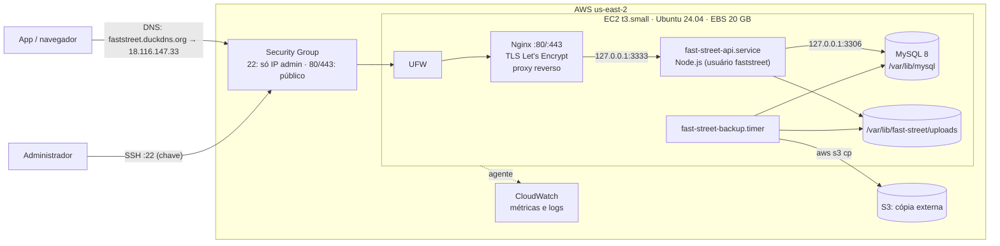

# Arquitetura

## O PROEX

**Fast Street** é um aplicativo para pilotos e organizadores de eventos automotivos: o piloto
cadastra a conta e a garagem de veículos, encontra eventos pelo feed (filtrados por distância) e
se inscreve; o organizador cria eventos e registra resultados. O app é **mobile (React Native/Expo)**;
por isso, conforme o item 1.3 (cenário 4) do enunciado, o componente implantado na EC2 é o
**serviço efetivamente usado pelo app: a Fast Street API** (Node.js 22 + Express 5 + MySQL 8).

Repositório: `th14goLM/Fast-Street` (privado; acesso combinado com o professor).

## Fluxo de uma requisição

Passo a passo de `GET https://faststreet.duckdns.org/cidades`:

1. O app resolve o nome no **DNS** (registro A no DuckDNS) → IP elástico `18.116.147.33`.
2. O pacote chega à VPC; o **Security Group** permite TCP 443 de qualquer origem.
3. No Ubuntu, o **UFW** também permite 443; o **Nginx** aceita a conexão e faz o *handshake* TLS
   com o certificado Let's Encrypt.
4. O Nginx aplica limite por IP, registra a requisição em `fast-street.access.log` e a encaminha
   (`proxy_pass`) para `127.0.0.1:3333` — a porta da API **não** é exposta à Internet.
5. A **API** (processo Node gerenciado pelo systemd, usuário sem privilégios) consulta o **MySQL**
   pelo loopback e devolve JSON.
6. O Nginx devolve a resposta ao app, já cifrada.

## Componentes, portas e responsáveis

| Componente | Onde | Porta / interface | Gerenciado por | Dono / usuário |
|---|---|---|---|---|
| Nginx | EC2 | 0.0.0.0:80, 0.0.0.0:443 | systemd (`nginx.service`) | root (master), www-data (workers) |
| Fast Street API | `/opt/fast-street/api` | **127.0.0.1:3333** | systemd (`fast-street-api.service`) | `faststreet` (sistema, sem shell) |
| MySQL 8.0 | `/var/lib/mysql` | **127.0.0.1:3306** | systemd (`mysql.service`) | `mysql` |
| App web (Expo, SPA) | `/var/www/fast-street-web/app` → `releases/<versão>` | servido pelo Nginx em `/app/` | — | root (644) |
| Fotos (uploads) | `/var/lib/fast-street/uploads` | — | — | `faststreet` (750) |
| Backup | `/var/backups/fast-street` → S3 | — | systemd timer | root (700) |
| DNS dinâmico | DuckDNS | — | systemd timer (`duckdns.timer`) | usuário dinâmico |
| SSH | EC2 | 0.0.0.0:22 (SG: só IP admin) | systemd (`ssh.service`) | contas individuais com sudo |

## Decisões e alternativas

| Decisão | Por quê | Alternativa considerada |
|---|---|---|
| Nginx no host (apt) em vez de Caddy em contêiner | Exigência do enunciado (R07/R08) e logs/serviço visíveis no systemd | Caddy (usado antes): HTTPS automático, mas fora do escopo da disciplina |
| API e MySQL como serviços systemd nativos (sem Docker em produção) | `systemctl stop/start`, `journalctl -u` e reinício automático exatamente como no item 9; menos RAM | Docker Compose sob uma unidade systemd: aceito como "mecanismo equivalente", mas esconde os processos atrás do Docker |
| API escuta só em 127.0.0.1 | Só o Nginx precisa alcançá-la; reduz a superfície exposta | Abrir 3333 no SG: desnecessário e inseguro |
| Código em `/opt` com dono root; serviço com usuário próprio | Se a API for comprometida, não consegue alterar o próprio código nem ler `/home` | Rodar como `ubuntu` ou root: viola o princípio do menor privilégio |
| DuckDNS (gratuito) + Let's Encrypt | Enunciado: HTTPS com DNS gratuito, sem comprar domínio | Domínio próprio + Route 53 (pago); sslip.io (não exercita configuração de DNS) |
| IP elástico | IP estável entre stop/start; DNS não precisa mudar | IP público automático: muda a cada stop/start |
| CloudWatch Agent | Métricas de memória/disco e logs fora da EC2, alarmes; cabe nos créditos | Prometheus + Grafana: consumiria ~400 MB da t3.small |
| Backup por systemd timer + S3 + cópia no PC | Cópia fora da EC2 (R12) com restauração testada | Snapshot EBS: complementar, mas restaura a máquina inteira |

## Limites (item 2.1 do enunciado)

Uma única EC2 é ponto único de falha: sem balanceador, réplica ou multi-AZ. Se a instância ou a
zona falhar, o serviço fica fora até a recuperação a partir do backup (RPO ≈ 24 h pelo backup
diário; RTO de minutos a horas, conforme o procedimento de restauração).
